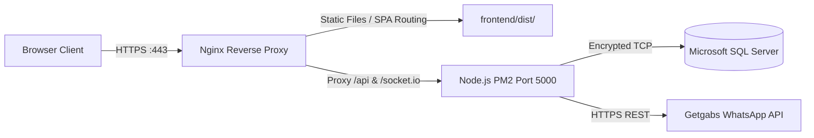

# Growth Ka Digital Partner (GDP) — Hostinger Compatibility & Deployment Feasibility Report

**Date:** October 23, 2026  
**Project:** Growth Ka Digital Partner (GDP) Podcast & Personal Branding Platform  
**Target Environment:** Hostinger Infrastructure / Production  
**Author:** Antigravity AI Technical Architecture & DevOps Agent  

---

## 1. Runtime & Infrastructure Requirements

The new GDP platform is an enterprise-grade web application consisting of two primary tiers:

```
┌───────────────────────────────────────────────┐
│              Client Browser                   │
└───────────────────────┬───────────────────────┘
                        │ HTTPS (Port 443)
                        ▼
┌───────────────────────────────────────────────┐
│        Nginx / Hostinger Web Server           │
│  - Serves static SPA (/index.html fallback)   │
│  - Proxies /api and /socket.io to backend     │
└───────────────┬───────────────────────────────┘
                │ Proxy HTTP (Port 5000)
                ▼
┌───────────────────────────────────────────────┐
│        Node.js Backend Daemon (PM2)           │
│  - Runtime: Node.js v20+ LTS (ES Modules)     │
│  - Framework: Express 5 + Socket.IO           │
│  - ORM: Prisma ORM v6                         │
└───────────────┬───────────────────────────────┘
                │ Encrypted TCP (Port 1433 / 15379)
                ▼
┌───────────────────────────────────────────────┐
│          Microsoft SQL Server                 │
│  - Database: GDPWebsiteDB                     │
│  - Connection: TCP/IP with TLS Encryption     │
└───────────────────────────────────────────────┘
```

### Detailed Tier Specifications

| Component | Technology | Build / Output | Hosting Prerequisite |
| :--- | :--- | :--- | :--- |
| **Frontend** | React 19 + TypeScript + Vite + Tailwind CSS v4 | Static SPA (`frontend/dist/`) | Any HTTP web server supporting client-side routing fallback (`/index.html`) |
| **Backend** | Node.js v20+ + Express 5 + Socket.IO | Compiled ES Modules (`backend/dist/`) | Persistent long-running process daemon (`pm2` or systemd) |
| **Database** | Microsoft SQL Server (`GDPWebsiteDB`) | SQL Server 2019/2022 instance | Outbound TCP socket access on port 1433/custom port with TLS encryption |
| **Real-time** | Socket.IO v4.8 | WebSocket + HTTP long-polling | Reverse proxy supporting `Upgrade` and `Connection` HTTP headers |
| **Notifications** | Getgabs WhatsApp Business REST API | Outbound HTTPS requests | Outbound network access on Port 443 |

---

## 2. Hostinger Hosting Plan Assessment

The existing live website ([growthkadigitalpartner.com](https://growthkadigitalpartner.com/)) is currently hosted on Hostinger. Hostinger offers multiple distinct tiers with fundamentally different technical capabilities:

### Tier A: Hostinger Shared / Cloud Web Hosting (hPanel)
- **Primary Purpose:** PHP, WordPress, and static HTML websites.
- **Node.js Support:** Very limited; usually supports only small headless scripts or Next.js static exports via basic Node selector (where supported). Does **not** permit persistent daemon background processes, WebSocket upgrades, or custom native TCP MSSQL drivers.
- **Compatibility Verdict:** **INCOMPATIBLE FOR DIRECT FULL-STACK DEPLOYMENT**. You cannot run the Node.js backend (`backend/src/index.ts`) or Socket.IO server on standard Hostinger shared hosting.

### Tier B: Hostinger Linux VPS (KVM 1 / KVM 2 / KVM 4)
- **Primary Purpose:** Full root Linux server (Ubuntu 22.04 / 24.04 LTS).
- **Node.js Support:** Full native support for Node.js v20+ LTS, PM2 process manager, Nginx reverse proxy, and free automated SSL (Let's Encrypt / Certbot).
- **Database Connectivity:** Direct encrypted TCP access to remote or local Microsoft SQL Server instances.
- **Compatibility Verdict:** **100% FULLY COMPATIBLE (RECOMMENDED ARCHITECTURE)**.

---

## 3. Feasible Deployment Architecture Options

### Option 1: Linux VPS Single-Server Architecture (Recommended)

Both the static frontend and the Node.js backend are hosted on a single Hostinger Linux VPS (or equivalent cloud instance) behind an Nginx reverse proxy.



- **Pros:**
  - Same-origin domain structure (`growthkadigitalpartner.com` and `growthkadigitalpartner.com/api` share the same domain).
  - First-party session cookies (`gdp.sid`) with `SameSite=Lax` work reliably across all browsers without being blocked.
  - Zero cross-domain CORS latency or preflight overhead.
  - Automated SSL certificate management via Certbot.
- **Complexity:** Medium (Standard Linux CLI, PM2, and Nginx configuration).
- **Estimated Cost:** ~$6–$12 / month (Hostinger KVM 2 VPS).

---

### Option 2: Decoupled Hybrid Architecture

Deploy the frontend static bundle to the current Hostinger Web Hosting account, and deploy the Node.js backend to a specialized Node container (Render, Railway, or VPS).

- **Pros:**
  - Leverages existing Hostinger shared hosting account for public static web assets.
- **Cons & Caveats:**
  - Requires split domain naming (e.g., `growthkadigitalpartner.com` for frontend and `api.growthkadigitalpartner.com` for backend).
  - Cross-origin session cookies require `SameSite=None; Secure`, which are increasingly restricted by Safari and Brave privacy shields.
  - Additional operational monitoring for two independent hosting providers.

---

## 4. Unknowns & Decisions Required from Stakeholders

Before executing any deployment actions, the following items require clarification:

1. **Exact Hostinger Plan Type:**
   - Does Bhavesh Sir currently have **Hostinger Web Hosting (Shared/hPanel)** or a **Hostinger Linux VPS**?
2. **Domain & DNS Management:**
   - Where are the domain DNS records managed (Hostinger DNS, Cloudflare, GoDaddy)?
   - Any DNS changes must preserve existing MX and SPF/DKIM records to prevent email disruptions.
3. **Microsoft SQL Server Production Instance:**
   - Will the production SQL database continue running on the current dedicated database server (`160.187.80.212:15379`), or will a separate production instance be provisioned?
4. **Target Rollout Window:**
   - Scheduled deployment window for zero-downtime cutover.
