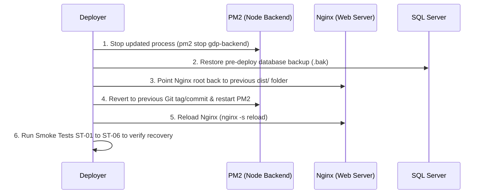

# GDP Podcast Website — Production Deployment Plan & Hosting Preparation

**Document Version:** 1.0.0  
**Project:** Growth Ka Digital Partner (GDP) Podcast & Personal Branding Platform  
**Target Environment:** Production  
**Date:** October 2026  
**Status:** READY FOR HOSTING DECISIONS (No deployment performed)

---

## 1. Executive Summary & Status

The GDP Podcast Website has completed Stages 1 through 5, including database schema design, public APIs, administrator authentication, interactive admin dashboard, WhatsApp Business API integration, and integration testing.

| Component | Current Development State | Production Readiness Status |
| :--- | :--- | :--- |
| **Frontend** | React 19 + Vite + TypeScript + Tailwind CSS | **Ready for Build**: `npm run build` succeeds (`dist/` generated, 0 lint/type errors) |
| **Backend** | Express 5 + TypeScript + Prisma ORM v6 | **Ready for Build**: `npm run build` succeeds (`dist/` generated via `tsc`, 0 type errors) |
| **Database** | Microsoft SQL Server (`GDPWebsiteDB`) | **Migrations In Sync**: 2 migrations applied; safe command identified (`prisma migrate deploy`) |
| **Authentication** | Session cookies (`gdp.sid`) + SQL Store + CSRF | **Secured**: `httpOnly: true`, `secure: true` in production, CSRF validation on all mutations |
| **Notifications** | Getgabs WhatsApp Business Integration | **Verified**: Lead alerts to team and client confirmation templates tested with API status 200 |
| **Deployment** | Localhost execution | **Pending Hosting Decisions**: Host selection, domain name, DNS records, SSL, and owner secrets |

> **IMPORTANT NOTICE:**  
> **No live deployment, DNS modification, server configuration, or database altering has taken place during this preparation stage.**

---

## 2. Assessment of Hosting Options

The existing technology stack consists of:
- **Frontend:** Static Single Page Application (SPA) requiring static file serving with client-side routing fallback (`/index.html`).
- **Backend:** Node.js v20+ long-running service with HTTP and WebSocket support (`"type": "module"`).
- **Database:** Microsoft SQL Server using TCP/IP with encryption (`encrypt=true`).

Three deployment options were evaluated for this stack:

```mermaid
graph TD
    subgraph Option A [Recommended: Linux VPS + Reverse Proxy]
        A1[Client Browser] -->|HTTPS 443| A2[Nginx / Caddy]
        A2 -->|Static Files / SPA Routing| A3[Frontend dist/]
        A2 -->|Proxy /api| A4[Node.js PM2 Port 5000]
        A4 -->|Encrypted TCP/IP| A5[(SQL Server GDPWebsiteDB)]
    end
    subgraph Option B [Windows Server + IIS]
        B1[Client Browser] -->|HTTPS 443| B2[IIS ARR / Caddy]
        B2 -->|Static Site| B3[Frontend dist/]
        B2 -->|Reverse Proxy /api| B4[Node.js Windows Service / PM2]
        B4 -->|Local or Remote TCP| B5[(SQL Server Instance)]
    end
    subgraph Option C [Decoupled Cloud: Vercel + Managed Node]
        C1[Client Browser] -->|HTTPS| C2[Vercel / Netlify CDN]
        C1 -->|CORS /api with Cookies| C3[Render / Railway Node Backend]
        C3 -->|Remote TCP| C5[(Remote SQL Server)]
    end
```



### Comparative Analysis Matrix

| Criterion | Option A: Linux VPS (Ubuntu) + Nginx + PM2 | Option B: Windows Server + IIS (or Nginx) | Option C: Managed PaaS (Vercel + Render) |
| :--- | :--- | :--- | :--- |
| **Recommended?** | **YES (Primary Recommendation)** | **YES (If Dedicated Windows Server exists)** | **Acceptable with Cross-Origin caveats** |
| **Same-Origin Routing** | Native (`/` for UI, `/api` proxy) | Native (`/` for UI, `/api` rewrite/proxy) | Split (`domain.com` vs `api.domain.com`) |
| **Session Cookie Security** | Standard `SameSite=Lax`, `Secure` | Standard `SameSite=Lax`, `Secure` | Requires `SameSite=None`, `Secure`, third-party cookie handling |
| **Node.js Compatibility** | Native Linux Node.js v20+ (ES Modules) | Requires PM2 or NSSM service | Native in container/PaaS |
| **SSL / TLS Certificate** | Automated via Let's Encrypt (Certbot/Caddy) | Automated via Win-ACME / Certify The Web | Automated by platform |
| **Static File Performance** | High (Nginx zero-copy sendfile, gzip/brotli) | High (IIS static file caching) | Very High (Global CDN edge network) |
| **Licensing Cost** | $0 OS license (open-source) | Windows Server OS licensing applies | Tier-based monthly platform subscriptions |
| **Operational Complexity** | Low-Medium (standard Linux CLI) | Medium (IIS ARR, Windows services) | Low initial setup, higher debugging complexity |

### Recommendation Rationale
**Option A (Linux VPS with Nginx and PM2) is the recommended architecture.**  
1. **Single-Domain Unification:** Hosting both frontend static files and the backend reverse proxy under the same primary domain (e.g., `https://yourdomain.com` and `https://yourdomain.com/api`) eliminates cross-domain CORS complexities and ensures session cookies (`gdp.sid`) work reliably without being blocked by modern browser third-party tracking protections.
2. **Resource Efficiency:** A 2 vCPU / 4 GB RAM Linux server easily serves millions of monthly requests with PM2 process supervision and Nginx static caching.
3. **Database Flexibility:** Node.js connects to SQL Server via encrypted TCP/IP regardless of whether SQL Server is on the same machine, a separate Windows box, or an Azure SQL instance.

---

## 3. Required Infrastructure & Pre-Deployment Access

Before executing the live deployment, the project owner must provide:

1. **Domain Name & DNS Access:**
   - Access to DNS management (Cloudflare, GoDaddy, Namecheap, etc.) to configure `A` or `CNAME` records.
2. **Hosting Environment Credentials:**
   - SSH access to Linux server (or RDP / Administrator access to Windows Server).
   - Node.js runtime (v20.10.0+ LTS recommended) and `npm` installed.
3. **Database Connection Details:**
   - Production SQL Server hostname or IP address, TCP port (default 1433 or custom port).
   - Production database name (e.g., `GDPWebsiteDB_Prod`).
   - Dedicated database user credentials with `db_datareader`, `db_datawriter`, and `db_ddladmin` permissions (never `sa`).
   - Network firewall rule permitting outbound TCP traffic from the Node.js server to the SQL Server port.
4. **Third-Party Service Credentials:**
   - Production Getgabs API key and registered WhatsApp sender number.
   - Initial production administrator email address.

---

## 4. Environment Variables Checklist

Create a secure `.env` file on the production server (in `backend/.env`). **Never commit this file to version control.**

### Backend Production Checklist (`backend/.env`)

| Variable | Required? | Recommended Production Value | Description |
| :--- | :--- | :--- | :--- |
| `NODE_ENV` | **Required** | `production` | Enables Express production optimizations, secure cookies, and strict error sanitization. |
| `PORT` | **Required** | `5000` | Port for the internal Node.js server (reverse proxied by Nginx/IIS). |
| `CLIENT_URL` | **Required** | `https://yourdomain.com,https://www.yourdomain.com` | Comma-separated list of trusted production origins permitted by CORS. |
| `SESSION_SECRET` | **Required** | Cryptographically random string (min 64 chars) | Used to sign session cookies. Generate via `openssl rand -hex 32`. |
| `DATABASE_URL` | **Required** | `sqlserver://<HOST>:<PORT>;database=<DB>;user=<USER>;password=<PWD>;encrypt=true;trustServerCertificate=false` | Microsoft SQL Server connection string. Use `trustServerCertificate=true` only if self-signed. |
| `GETGABS_API_URL` | Optional | `https://app.getgabs.com/whatsappbusiness/send-templated-message` | Getgabs WhatsApp Business API endpoint. |
| `GETGABS_API_KEY` | **Required** | `[Production API Key]` | Secret token from Getgabs dashboard. |
| `GETGABS_SENDER` | **Required** | `[Production Sender Mobile]` | Registered business phone number (with country code, e.g., `91...`). |
| `GETGABS_TEAM_PHONE` | **Required** | `[Production Team Mobile]` | Phone number to receive real-time WhatsApp lead alerts. |
| `GETGABS_CAMPAIGN_ID` | Optional | `[Production Campaign ID]` | Template campaign ID in Getgabs. |
| `ADMIN_INITIAL_EMAIL` | Optional | `[Admin Email]` | Used only once during initial `npm run admin:provision`. Remove after setup. |
| `ADMIN_INITIAL_PASSWORD` | Optional | `[Strong Password]` | Used only once during initial `npm run admin:provision`. Remove after setup. |
| `ADMIN_INITIAL_NAME` | Optional | `"GDP Administrator"` | Display name for the initial administrator. |

### Frontend Production Checklist (`frontend/.env.production`)

| Variable | Required? | Production Value | Description |
| :--- | :--- | :--- | :--- |
| `VITE_API_URL` | Optional | `""` *(Empty string for same-origin)* | If backend is reverse-proxied at `/api` on the same domain, leave empty. If hosted on a separate subdomain, set to `https://api.yourdomain.com`. |

> **CAUTION:** In Vite, all variables prefixed with `VITE_` are publicly embedded into the browser's JavaScript bundle. **Never store database credentials, API keys, or session secrets in `frontend/.env`!**

---

## 5. Administrator Security & Password Rotation

### Account Protection Verification
- Admin endpoints (`/api/admin/*`) strictly enforce `requireAdmin` and `requireAuth` middleware.
- Accounts with `status !== 'ACTIVE'` or `role !== 'ADMIN'` are immediately denied with 401/403 responses, and stale sessions are destroyed.
- State-mutating requests (`POST`, `PUT`, `PATCH`, `DELETE`) require a cryptographically random CSRF token (`x-csrf-token`) validated against the database-backed session.
- Session regeneration is enforced upon successful login to prevent session fixation attacks.

### Safe Initial Provisioning vs. Password Rotation
1. **Initial Provisioning (`npm run admin:provision`):**
   - Verified behavior: The script checks if an active `ADMIN` already exists in `dbo.User`. If found, **it will NOT overwrite or reset the password**.
   - It is designed strictly for first-time system bootstrap.
2. **Password Rotation (`npm run admin:rotate-password`):**
   - A dedicated secure password rotation tool has been added to `backend/src/scripts/rotateAdminPassword.ts`.
   - **Procedure:**
     ```bash
     # Verified command for this repository (execute on the secure server terminal):
     npm run admin:rotate-password -- admin@yourdomain.com "NewStrongRandomPassword123!"
     ```
   - **Security Guarantees:**
     - Uses `bcrypt` with 12 salt rounds.
     - Immediately terminates all existing active sessions for that administrator in `dbo.Session` to revoke compromised cookies.
     - Automatically logs an entry in `dbo.AuditLog` (`ADMIN_PASSWORD_ROTATED`).
     - Never logs or exposes credentials in application logs.

---

## 6. Database Deployment & Migration Procedure

### Strategy: Production Database Separation
- **Do not mix development and production data.** Production must run on a dedicated production database instance or catalog (e.g., `GDPWebsiteDB_Prod`).
- Development data, test episodes, and test inquiries must not be imported into production.

### Safe Production Migration Command
```bash
# VERIFIED COMMAND for this repository:
# In the backend directory on the production server:
npx prisma migrate deploy
```

> **WARNING:**  
> - **NEVER run `npx prisma migrate dev` in production.** It creates new migration files and prompts interactively.  
> - **NEVER run `npx prisma db push` or `npx prisma migrate reset` in production.** `db push` can silently drop columns, and `migrate reset` drops the entire database!  
> - `npx prisma migrate deploy` safely applies only the pending migrations from `prisma/migrations/` and records them in `dbo._prisma_migrations`.

### Database Backup & Recovery Plan
Before deploying any migration or version upgrade, perform a full database backup in Microsoft SQL Server Management Studio (SSMS) or via SQLCMD:

```sql
-- EXAMPLE Transact-SQL Backup Command:
BACKUP DATABASE [GDPWebsiteDB_Prod]
TO DISK = 'C:\SQL_Backups\GDPWebsiteDB_Prod_PreDeploy.bak'
WITH FORMAT, COMPRESSION, CHECKSUM,
NAME = 'Full Backup of GDPWebsiteDB_Prod Pre-Deployment';
GO

-- Verify backup integrity:
RESTORE VERIFYONLY
FROM DISK = 'C:\SQL_Backups\GDPWebsiteDB_Prod_PreDeploy.bak';
GO
```

**Recommended Backup Schedule:**
- **Daily:** Full automated database backup (30-day retention).
- **Hourly:** Differential or transaction log backup (for point-in-time recovery).
- **Off-site:** Encrypted copy shipped to cloud storage (e.g., AWS S3 or Azure Blob Storage).

---

## 7. Step-by-Step Build & Deployment Sequence

### Step A: Repository Setup on Server
```bash
# Clone the repository onto the server (example):
git clone <YOUR_GIT_REPO_URL> /var/www/gdp-website
cd /var/www/gdp-website
```

### Step B: Backend Preparation & Build
```bash
# Navigate to backend and install production dependencies
cd /var/www/gdp-website/backend
npm ci

# Configure production environment variables
cp .env.example .env
nano .env # Populate with production secrets

# Generate Prisma Client
npm run prisma:generate

# Apply production database migrations safely
npx prisma migrate deploy

# Compile TypeScript to JavaScript
npm run build
```

### Step C: Initial Administrator Bootstrap
```bash
# Run provisioning once to create initial admin
npm run admin:provision

# Immediately remove or unset ADMIN_INITIAL_PASSWORD from .env
```

### Step D: Frontend Build & Static Packaging
```bash
# Navigate to frontend and install dependencies
cd /var/www/gdp-website/frontend
npm ci

# Ensure VITE_API_URL is configured (or empty for same-origin proxy)
# Build production SPA assets
npm run build
# Output files are generated in /var/www/gdp-website/frontend/dist
```

### Step E: Process Supervision with PM2 (Backend)
```bash
# Start backend service using PM2
pm2 start /var/www/gdp-website/backend/dist/index.js --name "gdp-backend" -i max
pm2 save
pm2 startup
```

### Step F: Nginx Configuration (Example for Linux)
```nginx
# /etc/nginx/sites-available/gdpstudio.com
server {
    listen 80;
    server_name yourdomain.com www.yourdomain.com;
    return 301 https://$host$request_uri;
}

server {
    listen 443 ssl http2;
    server_name yourdomain.com www.yourdomain.com;

    ssl_certificate /etc/letsencrypt/live/yourdomain.com/fullchain.pem;
    ssl_certificate_key /etc/letsencrypt/live/yourdomain.com/privkey.pem;

    # Static Frontend SPA
    root /var/www/gdp-website/frontend/dist;
    index index.html;

    # Client-side routing fallback
    location / {
        try_files $uri $uri/ /index.html;
    }

    # Static asset caching (1 year for immutable hashed assets)
    location ~* \.(?:css|js|woff2?|svg|png|jpg|jpeg|webp)$ {
        expires 1y;
        add_header Cache-Control "public, immutable";
    }

    # Backend API Reverse Proxy
    location /api {
        proxy_pass http://127.0.0.1:5000;
        proxy_http_version 1.1;
        proxy_set_header Upgrade $http_upgrade;
        proxy_set_header Connection 'upgrade';
        proxy_set_header Host $host;
        proxy_set_header X-Real-IP $remote_addr;
        proxy_set_header X-Forwarded-For $proxy_add_x_forwarded_for;
        proxy_set_header X-Forwarded-Proto $scheme;
        proxy_cache_bypass $http_upgrade;

        # Timeouts for background jobs and WhatsApp API calls
        proxy_connect_timeout 60s;
        proxy_send_timeout 60s;
        proxy_read_timeout 60s;
    }
}
```

---

## 8. Post-Deployment Smoke Testing Protocol

Execute these smoke tests immediately following deployment to verify all live components:

| Test ID | Area | Endpoint / Page | Expected Result |
| :--- | :--- | :--- | :--- |
| **ST-01** | Public UI | `https://yourdomain.com/` | Homepage loads cleanly with styling, header, navigation, and footer. |
| **ST-02** | Health API | `https://yourdomain.com/api/health` | Returns HTTP 200 with JSON `{ status: "ok", service: "..." }`. |
| **ST-03** | Episodes API | `https://yourdomain.com/api/episodes` | Returns HTTP 200 with published episodes array. |
| **ST-04** | Guest Application | `https://yourdomain.com/guests` | Submits form; returns HTTP 201; lead alert WhatsApp received on team phone. |
| **ST-05** | Contact Form | `https://yourdomain.com/contact` | Submits form; returns HTTP 201; client gets WhatsApp confirmation (`portfolio_enquiry_receive`). |
| **ST-06** | Admin Login | `https://yourdomain.com/admin/login` | Valid credentials redirect to `/admin/dashboard`; `gdp.sid` cookie issued with `Secure; HttpOnly; SameSite=Lax`. |
| **ST-07** | Admin Dashboard | `https://yourdomain.com/admin/dashboard` | Displays real database stats for episodes, guests, and messages. |
| **ST-08** | Content Management | `https://yourdomain.com/admin/episodes` | Creating/updating a draft and publishing reflects on public `/episodes` immediately. |
| **ST-09** | CSRF Enforcement | State-mutating admin requests | Request without `x-csrf-token` header is rejected with HTTP 403. |
| **ST-10** | Admin Logout | `https://yourdomain.com/admin/logout` | Session destroyed in `dbo.Session`; cookie cleared; redirects to login. |

---

## 9. Rollback & Disaster Recovery Procedure

If a critical failure occurs during deployment:



### Rollback Steps
1. **Frontend Rollback:** Keep previous build artifacts (`dist_prev/`). In Nginx, switch root to `dist_prev/` and execute `nginx -t && nginx -s reload`. (Execution time: < 30 seconds).
2. **Backend Rollback:** Check out previous stable Git tag (`git checkout tags/vX.X.X`), reinstall dependencies if necessary (`npm ci`), run `npm run build`, and restart PM2 (`pm2 restart gdp-backend`).
3. **Database Rollback:** If a migration corrupted schema or data, restore the pre-deployment database backup file (`.bak`).

---

## 10. Post-Deployment Monitoring & Maintenance Checklist

- [ ] **PM2 Monitoring:** Monitor process uptime, CPU, and memory using `pm2 monit` or PM2 Plus.
- [ ] **Log Rotation:** Configure `pm2-logrotate` to prevent disk overflow:
  ```bash
  pm2 install pm2-logrotate
  pm2 set pm2-logrotate:max_size 10M
  pm2 set pm2-logrotate:retain 14
  ```
- [ ] **SSL Auto-Renewal:** Verify Certbot timer (`systemctl status certbot.timer` or `certbot renew --dry-run`).
- [ ] **WhatsApp Delivery Rates:** Periodically review Getgabs delivery status in Getgabs dashboard for template approvals and API balance.
- [ ] **Database Session Cleanup:** Verify `PrismaSessionStore` hourly prune interval operates without database errors.
- [ ] **Audit Trail Monitoring:** Review `dbo.AuditLog` for unusual failed admin login attempts (`ADMIN_LOGIN_FAILED`).

---

## 11. Outstanding Owner Decisions & Blockers

The following items require input or decisions from the website owner before execution:

1. **Target Hosting Infrastructure:**
   - Decision on hosting provider (Linux VPS on DigitalOcean/AWS/Hetzner vs. dedicated Windows Server).
2. **Live Domain Name:**
   - Final domain name (e.g., `gdppodcast.com` or `growthkadigitalpartner.com`).
3. **SQL Server Production Instance:**
   - Confirm whether the existing remote SQL Server (`160.187.80.212:15379`) will be used for production or if a separate production database will be provisioned.
4. **Production Administrator Password:**
   - Assign final production administrator credentials during initial server provisioning.
5. **Git Repository Setup:**
   - The workspace directory is currently not initialized as a Git repository. A repository (GitHub/GitLab) should be initialized to enable version-controlled deployments.

---

*This document was compiled and verified against the existing GDP Website codebase.*
